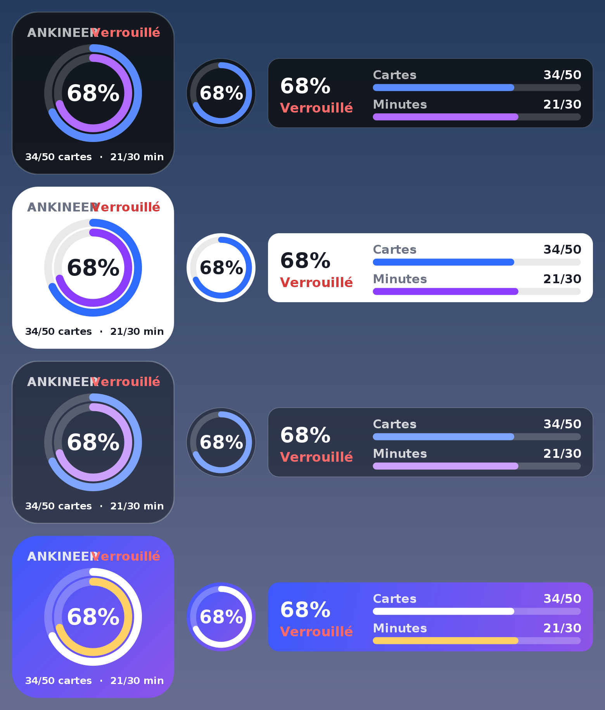
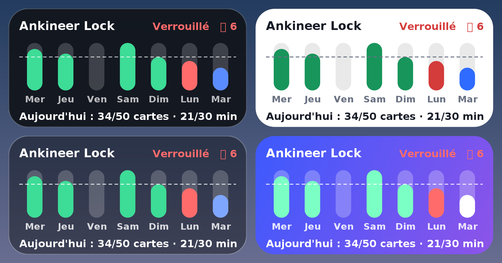

# 🔒 Ankineer Lock

**Your phone unlocks once your Anki cards are done.**

<p align="center">
  <a href="https://github.com/BONJ37/ankineer-lock/releases/latest"></a>
  <a href="https://github.com/BONJ37/ankineer-lock/actions/workflows/build.yml"></a>
  
  
  
</p>

Ankineer Lock is a free, open-source Android app for **AnkiDroid** users. It blocks distracting apps (social media, videos, games…) until you have done your daily Anki work. AnkiDroid, phone calls, SMS and the apps you choose always stay available.

The numbers are exactly the ones AnkiDroid shows (“Studied X cards in Y minutes today”), read from AnkiDroid's review history — so reviews done on your computer count too, once AnkiDroid is synced.

> Made by **Ankineer** · Android 6+ · French / English · dark & light themes · *[Version française plus bas](#-version-française)*

---

## 📥 Download & install

1. Download the latest **`Ankineer-Lock-*.apk`** from **[Releases](https://github.com/BONJ37/ankineer-lock/releases/latest)**.
2. Open it and allow the install. *Play Protect may show a warning because the app is not on the Play Store — this is expected.*
3. Open **Ankineer Lock → ☰ → Setup** and follow the 8 steps (each one shows ✓ when done):

| Step | What to do |
|---|---|
| 1 | Install AnkiDroid and allow Ankineer Lock to read its data |
| 2 | **Android 13+ only:** *App info → ⋮ → Allow restricted settings* |
| 3 | Turn on the accessibility service **“Ankineer – Anki Lock”** |
| 4 | Turn off battery optimisation (so Android doesn't stop the lock) |
| 5 | Allow notifications · on Xiaomi / Oppo / Vivo / Huawei also allow *Autostart* |
| 6 | Choose the apps that stay allowed |
| 7 | Set your daily goal |
| 8 | Test the block for 1 minute — the lock then **starts on its own** |

---

## ✨ Features

### 🎯 Daily goal
The phone stays locked until you reach **both** thresholds: a number of cards (minimum 50) **and** study minutes (minimum 15). You can raise them anytime, and lower them (or reset them to the minimum) only while your phone is free.

### 📚 Due cards
Two optional rules: *unlock as soon as all due cards are done* (if nothing is left to review, the thresholds don't apply), or *also require 0 due cards*. The Home screen shows a progress bar of today's due cards.

### ⏱ Focus sessions
A one-off target you set yourself (for example 40 cards or 25 minutes). Everything is locked — even if the daily goal is already reached — until the session is complete. Progress is read from AnkiDroid's history, so it stays exact even past midnight.

### 🏠 Home screen
Two progress rings (cards and minutes, green once the threshold is reached), the due-card bar, the lock state, the big **Start** button and the session form.

### 🚨 Emergencies
For real emergencies only, each once a day, each preceded by a big warning (“this is an exceptional permission — get back to your reviews quickly”):
- **Code** — frees the phone right away (15 min by default), 5 attempts max. Best if someone you trust picks the code.
- **Extreme emergency** — 5 minutes right away.

Changing the phone's clock does not reset the daily limits. An emergency frees your apps but never lets you stop the lock or lower the goal.

### 🛡 Protection
- **Strict mode:** while locked, Android Settings and uninstalling are blocked (battery settings and app updates stay possible).
- **Block uninstalling forever** (optional): even when the phone is free, the uninstall window, the Play Store page, *App info* and the accessibility setting of Ankineer Lock are blocked. Turning it off requires a free phone **and a 24-hour wait**.

### 🎉 Success window
When you reach your daily goal or finish a session, a big window appears — even over AnkiDroid — with your numbers, your streak 🔥 and a motivational quote.

### 🔔 Hourly reminders
Two separate notifications, at most one of each per hour: *“Still N due cards”* and *“Minimum goal not reached yet”*, each with a different quote (Hippocrates, Pasteur, Osler, Seneca, Marcus Aurelius…). Quiet hours are adjustable (11 pm → 8 am by default). You are also warned if Android has stopped the lock service.

### 📊 Statistics
- 7 days / 30 days / 1 year: current and best streak (computed retroactively from AnkiDroid's history), averages, time per card, record, trend.
- **Today's retention vs. your overall retention** (Anki's “true retention”: answers other than *Again* on review cards).
- Cards-per-day chart (green = above your threshold), minutes per day, most productive weekday, 1-year activity heatmap.
- A calendar of the last 365 days, including the days before you installed the app; tap a day for its cards, minutes and retention.

### 🧩 Home-screen widgets
Four widgets — rings (2×2), mini ring (1×1), cards · minutes bars (4×1), week + streak (4×2) — in four styles: dark, light, glass and gradient. A small floating progress circle can also stay at the top of the screen while locked.

<p align="center"></p>
<p align="center"></p>

### ⬆ In-app updates
Download the new APK, then **☰ → Update → Choose the new APK**. The app checks that it really is Ankineer Lock (same signature, same or newer version) and installs it **without uninstalling**: your settings and statistics are kept.

### 🧯 Crash safety
If something goes wrong, the app shows an error message instead of closing, keeps a rescue screen with the Update page, and records a crash report you can copy from the Home screen and paste into a [bug report](https://github.com/BONJ37/ankineer-lock/issues/new/choose).

---

## 🔐 Permissions & privacy

| Permission | Why |
|---|---|
| AnkiDroid database | read your card count, study time, due cards and retention |
| Accessibility service | know which app is in the foreground to block the ones you didn't allow |
| Notifications, exact alarms, start at boot | hourly reminders |
| Install apps | in-app updates |
| Ignore battery optimisation | keep Android from stopping the lock |

**No Internet permission at all.** Nothing is sent anywhere, and screen content is never read or stored. Everything stays on your phone.

## ⚠️ Limitations
- Not on Google Play (strict rules for accessibility services): distributed through GitHub.
- Android **safe mode** disables all installed apps, including Ankineer Lock.
- Settings screens differ between brands: if an uninstall screen is not blocked on your phone, please [open an issue](https://github.com/BONJ37/ankineer-lock/issues/new/choose) with your phone model.

## 🛠 Build from source

On Ubuntu 24.04 (this is exactly what GitHub Actions does, see [`.github/workflows`](.github/workflows)):

```bash
sudo apt install aapt zipalign apksigner dalvik-exchange android-sdk-platform-23 libasm-java libandroid-json-java python3-pil
bash build.sh        # compiles, runs the smoke test, signs with a local TEST key
```

The **smoke test** (`tests/smoke`) runs the whole app on the JVM with a simulated Android framework: every page in 14 states, every button, the blocking service, widgets, reminders, updates and simulated failures. No APK is produced unless it passes.

Official APKs are built and signed by GitHub Actions with the release key stored in the repository's encrypted *Secrets* — never in the code.

## 📄 License

[GPL-3.0](LICENSE) © Ankineer. Ankineer Lock is **not affiliated** with AnkiDroid or Anki; it uses AnkiDroid's official API.

---

## 🇫🇷 Version française

**Ton téléphone se débloque quand tes cartes Anki sont faites.** Ankineer Lock bloque les applications qui distraient tant que ton objectif du jour dans AnkiDroid (cartes **et** minutes, révisions sur PC comprises après synchronisation) n'est pas atteint. AnkiDroid, le téléphone, les SMS et les apps que tu autorises restent toujours accessibles.

- **Installer :** télécharge le dernier APK dans [Releases](https://github.com/BONJ37/ankineer-lock/releases/latest), puis ouvre **☰ → Installation** et suis les 8 étapes (Android 13+ : *Infos de l'app → ⋮ → Autoriser les paramètres restreints* avant d'activer le service « Ankineer – Verrou Anki »).
- **Fonctions :** objectif du jour, cartes dues, sessions, urgences (code, extrême urgence), mode strict et blocage permanent de la désinstallation, fenêtre de succès, rappels chaque heure avec citation, statistiques (séries, rétention du jour vs globale, graphiques, agenda), widgets, mise à jour sans désinstaller.
- **Vie privée :** aucune autorisation Internet, rien n'est envoyé, le contenu des écrans n'est jamais lu.
- **Un problème ?** [Ouvre une issue](https://github.com/BONJ37/ankineer-lock/issues/new/choose) avec ton modèle de téléphone et le rapport de plantage copié depuis l'Accueil.
